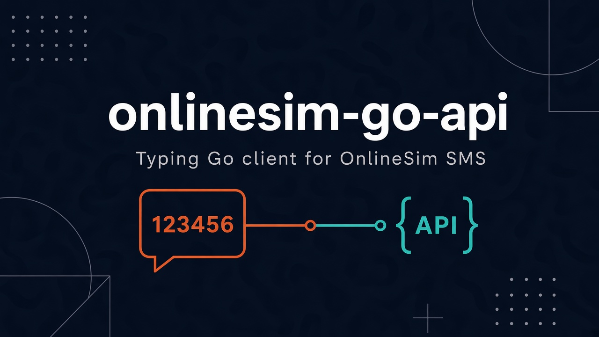

# onlinesim-go-api

[](https://github.com/s00d/onlinesim-go-api/actions/workflows/ci.yml)
[](https://pkg.go.dev/github.com/s00d/onlinesim-go-api/v3)

<p align="center">
  
</p>

Typed Go client for the [OnlineSim](https://onlinesim.io) API: SMS numbers, rent, account and free numbers.
Standard library only, Go 1.22+, `context`-first methods, a local mock for tests.

```bash
go get github.com/s00d/onlinesim-go-api/v3
```

```go
client := onlinesim.New(os.Getenv("ONLINESIM_KEY"))

b, err := client.User().Balance(ctx)
if err != nil {
	return err
}
fmt.Printf("available: %.2f USD\n", b.Balance-b.Zbalance)

order, err := client.Numbers().GetWithNumber(ctx, "google", 44)
if err != nil {
	return err
}
fmt.Println("enter", order.Number, "in the app")
code, err := client.Numbers().WaitCode(ctx, order.Tzid, onlinesim.WaitCodeOptions{})
fmt.Println("code:", code, err)
```

Documentation: **https://s00d.github.io/onlinesim-go-api/** · Upgrading from v2: [migration table](https://s00d.github.io/onlinesim-go-api/changelog#migrating-from-v2) · Changes: [CHANGELOG.md](CHANGELOG.md) · License: Apache-2.0
